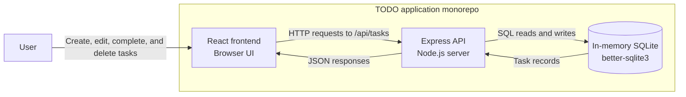
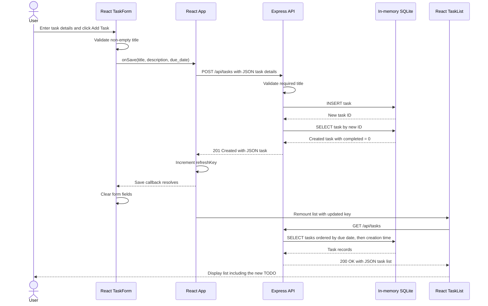

# Cloud Architecture Overview

## Current System Context

This monorepo contains a React frontend and an Express API backed by an in-memory SQLite store. These diagrams describe the current implementation, not a proposed cloud deployment or the PRD's future browser-local persistence.

- **Frontend:** [App.js](../packages/frontend/src/App.js) coordinates saving and list refreshes; [TaskForm.js](../packages/frontend/src/TaskForm.js) collects task details; [TaskList.js](../packages/frontend/src/TaskList.js) fetches and displays tasks.
- **API:** [app.js](../packages/backend/src/app.js) implements task CRUD routes. [index.js](../packages/backend/src/index.js) starts the server on `PORT`, defaulting to `3030`.
- **Development routing:** The React development server proxies API requests to `http://localhost:3030`, as configured in [package.json](../packages/frontend/package.json).
- **Store:** SQLite runs inside the API process using `new Database(':memory:')`. Task data is lost when that process stops; there is no durable database or browser-local task storage in the current implementation.

## Creating a TODO

The following sequence shows a successful creation request. The title is required; description and due date are optional. The current API field name is `due_date`, and priority is not yet implemented.

For invalid titles, the form blocks submission and the API independently returns `400` if such a request reaches it. The diagram is deliberately limited to the successful path: the current save handler awaits the request but does not check its HTTP status or consume the returned task before refreshing the list.
