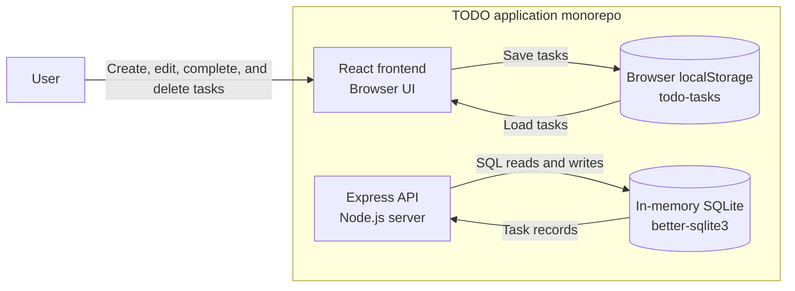
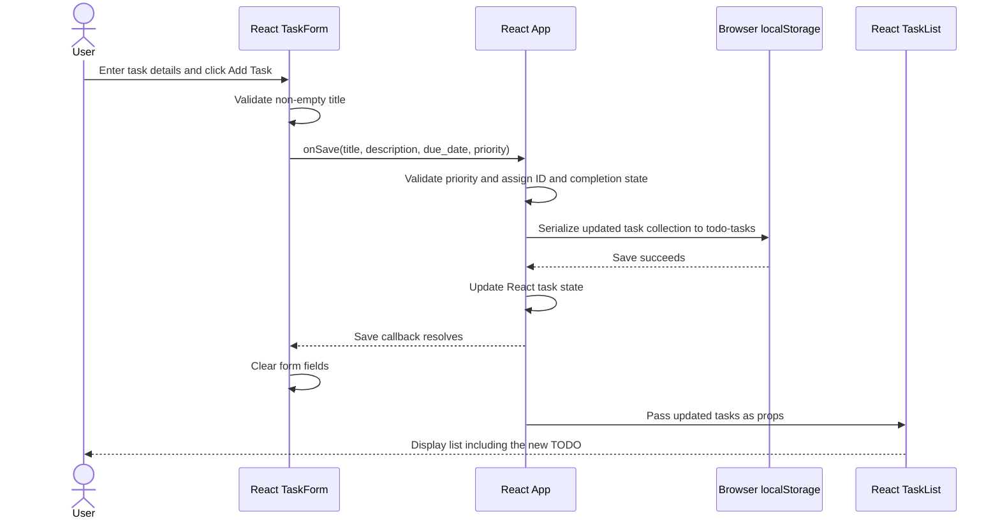

# Cloud Architecture Overview

## Current System Context

This monorepo contains a React frontend and an Express API backed by an in-memory SQLite store. Following the priority-field story, the frontend stores tasks in browser localStorage and no longer calls the API. The backend remains available independently and unchanged; these diagrams do not prescribe a cloud deployment.

- **Frontend:** [App.js](../packages/frontend/src/App.js) owns task state and persistence; [TaskForm.js](../packages/frontend/src/TaskForm.js) collects task details; [TaskList.js](../packages/frontend/src/TaskList.js) displays tasks and row-level priority controls.
- **Browser storage:** [taskStorage.js](../packages/frontend/src/taskStorage.js) loads and saves the task collection under `todo-tasks`, validates priorities, and defaults legacy records without priority to `P3`.
- **API:** [app.js](../packages/backend/src/app.js) implements task CRUD routes. [index.js](../packages/backend/src/index.js) starts the server on `PORT`, defaulting to `3030`.
- **Development routing:** The development proxy to `http://localhost:3030` remains configured in [package.json](../packages/frontend/package.json), but the frontend no longer sends task requests.
- **Backend store:** SQLite runs inside the API process using `new Database(':memory:')`. API task data is lost when that process stops and is separate from browser-local tasks. Existing API tasks are not automatically migrated.

## Creating a TODO

The following sequence shows successful local task creation. The title is required; description and due date are optional. The frontend retains `due_date` and supports `P1`, `P2`, and `P3`, defaulting to `P3`.

For invalid titles, the form blocks submission. Failed storage writes are surfaced to the user without clearing the form or changing the task list. Corrupt stored collections are reported rather than silently overwritten.
