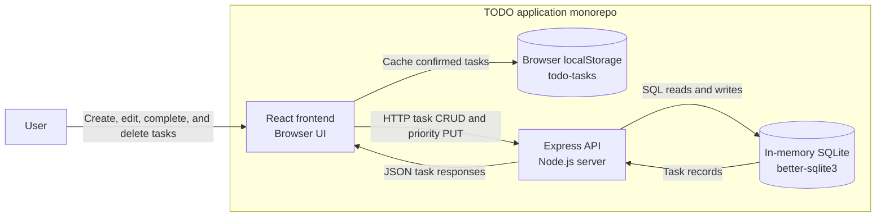
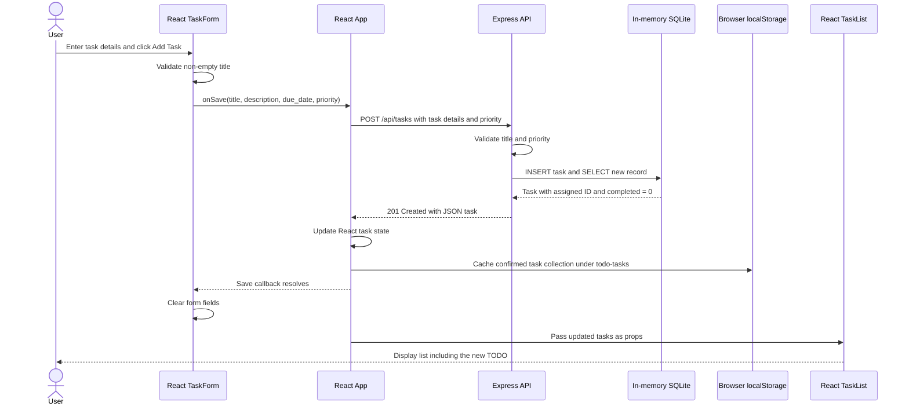

# Cloud Architecture Overview

## Current System Context

This monorepo contains a React frontend and an Express API backed by an in-memory SQLite store. The API is the source of truth for tasks; the frontend caches confirmed task records in browser localStorage. These diagrams describe the implementation, not a proposed cloud deployment.

- **Frontend:** [App.js](../packages/frontend/src/App.js) owns task state and persistence; [TaskForm.js](../packages/frontend/src/TaskForm.js) collects task details; [TaskList.js](../packages/frontend/src/TaskList.js) displays tasks and row-level priority controls.
- **Browser cache:** [taskStorage.js](../packages/frontend/src/taskStorage.js) serializes confirmed tasks under `todo-tasks`. The app loads from the API, not this cache, so stale browser-only IDs are not sent to the backend.
- **API:** [app.js](../packages/backend/src/app.js) implements task CRUD routes. [index.js](../packages/backend/src/index.js) starts the server on `PORT`, defaulting to `3030`.
- **Priority updates:** The frontend uses `PUT /api/tasks/:id/priority` with `{priority}`. The API validates P1/P2/P3, updates only priority, and returns the task. Full edits also accept priority; creation defaults it to P3.
- **Development routing:** The development proxy forwards API requests to `http://localhost:3030`, as configured in [package.json](../packages/frontend/package.json).
- **Backend store:** SQLite runs inside the API process using `new Database(':memory:')`. API task data is lost when that process stops. Browser-only tasks from the earlier local-storage implementation are not automatically imported.

## Creating a TODO

The following sequence shows successful API-backed creation. The title is required; description and due date are optional. Tasks retain `due_date` and support `P1`, `P2`, and `P3`, defaulting to `P3`.

For invalid titles, the form blocks submission and the API independently rejects invalid requests. Failed API saves are surfaced without clearing unsaved input. Cache failures are reported separately while the UI retains the confirmed backend state; there is no silent offline fallback.
